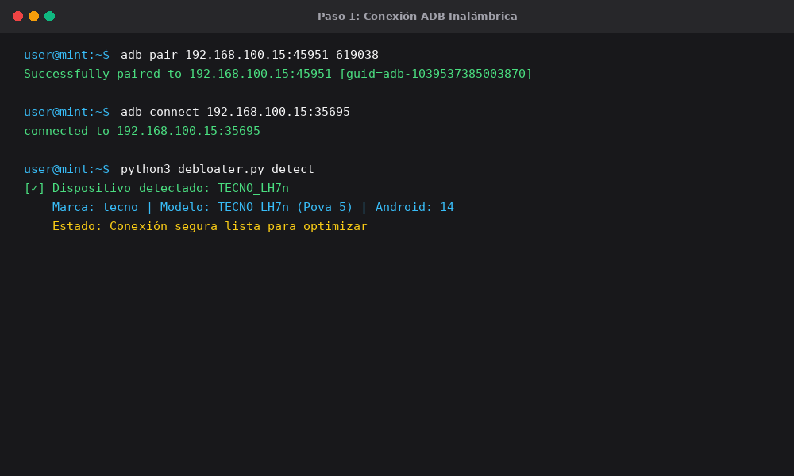
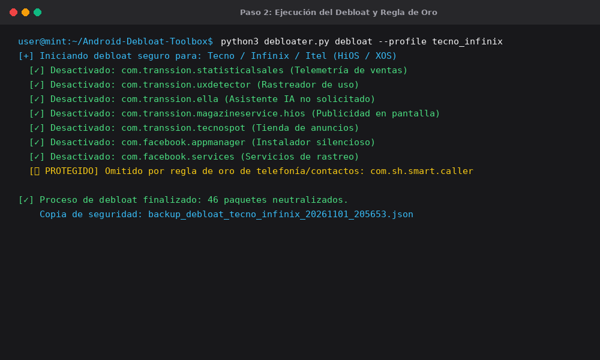
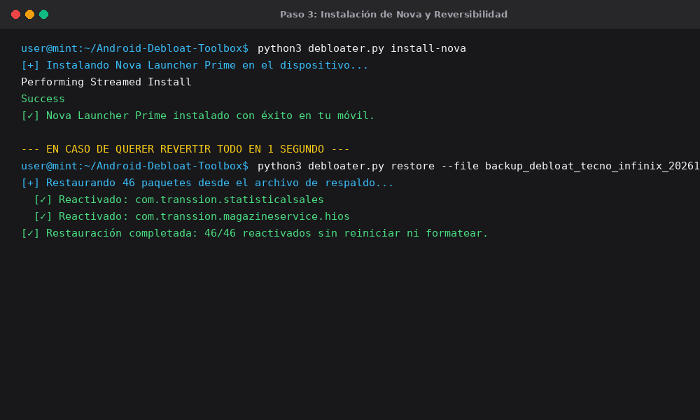
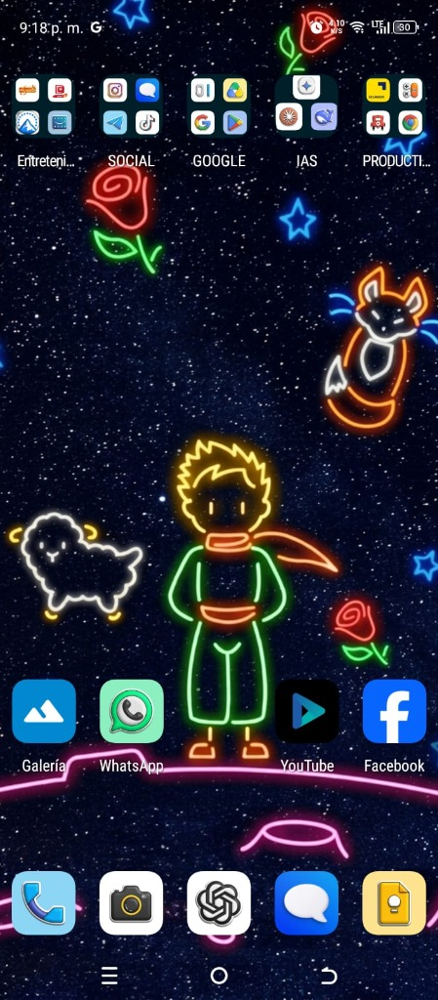

# 🎬 Guía Completa & Guion para Video Tutorial: Debloat Android + Nova Launcher

  

> **Repositorio Oficial:** [https://github.com/darwinsin822/Android-Debloat-Toolbox](https://github.com/darwinsin822/Android-Debloat-Toolbox)  
> **Objetivo:** Liberar memoria RAM, eliminar publicidad y rastreo sin root y sin perder llamadas ni contactos, dejando el móvil con Nova Launcher Prime.

---

## ⏱️ Guion Técnico Minuto a Minuto (Para grabar o usar voz con IA)

### 📌 INTRODUCCIÓN (00:00 - 00:30)
* **Visual en pantalla:** Mostrar la pantalla de inicio limpia de Nova Launcher (`assets/nova_launcher_preview.jpg`) y luego una animación o captura con el repositorio en GitHub.
* **Locución / Voz en off:**  
  *"¿Sientes que la batería de tu Android no dura lo suficiente o que tu teléfono viene saturado de aplicaciones basura, anuncios y tiendas chinas que nunca pediste? Hoy te voy a enseñar cómo limpiar a fondo tu celular utilizando **Android Debloat Toolbox**. Vamos a eliminar más de 45 procesos invisibles de telemetría y publicidad sin ser root, sin formatear, protegiendo al 100% tus llamadas y contactos, e instalando **Nova Launcher Prime** para dejarlo súper fluido. ¡Comencemos!"*

---

### 📌 PASO 1: CONEXIÓN ADB POR WIFI (00:30 - 01:15)
* **Visual en pantalla:** Grabación de pantalla del móvil activando la depuración inalámbrica (`Opciones de Desarrollador → Depuración Inalámbrica → Vincular`). Al lado, captura de terminal ejecutando el comando de emparejamiento.
* **Imagen del repositorio:** `assets/tutorial/01_conexion_adb.png`

  

* **Locución / Voz en off:**  
  *"El primer paso es activar la depuración en nuestro Android. Vamos a Ajustes, Información del teléfono, y tocamos 7 veces en 'Número de compilación'. Ahora en Opciones de Desarrollador activamos 'Depuración inalámbrica' y pulsamos en 'Vincular dispositivo con código'. En nuestra computadora, abrimos una terminal y ejecutamos `adb pair <IP>:<puerto>` con el código de 6 dígitos. Una vez emparejado, nos conectamos con `adb connect <IP>:<puerto_depuracion>`. Con `python3 debloater.py detect`, el script reconocerá automáticamente tu móvil."*

---

### 📌 PASO 2: EL DEBLOAT Y LA REGLA DE ORO (01:15 - 02:15)
* **Visual en pantalla:** Terminal corriendo el script de debloat, viendo cómo se desactivan los paquetes uno por uno y cómo se resalta la protección de telefonía.
* **Imagen del repositorio:** `assets/tutorial/02_ejecucion_debloat.png`

  

* **Locución / Voz en off:**  
  *"Ahora viene la magia. En la carpeta del proyecto ejecutamos `python3 debloater.py debloat --profile tecno_infinix` (o seleccionas tu marca: Xiaomi, Samsung, etc.). Fíjense en lo importante: el script cuenta con una **Regla de Oro de Protección**. A diferencia de otros métodos que te borran el teléfono y te quedas sin poder hacer llamadas, este script detecta y protege automáticamente tu marcador telefónico, libreta de contactos y SMS. En cuestión de 5 segundos, desactivó 46 servicios de anuncios, rastreadores en segundo plano y apps de Facebook preinstaladas."*

---

### 📌 PASO 3: REVERSIBILIDAD TOTAL Y NOVA LAUNCHER (02:15 - 03:00)
* **Visual en pantalla:** Terminal instalando Nova Launcher y mostrando el comando de restauración.
* **Imagen del repositorio:** `assets/tutorial/03_nova_y_reversibilidad.png`

  

* **Locución / Voz en off:**  
  *"¿Y si algún día quiero recuperar alguna aplicación? Cero preocupaciones: el debloat no borra particiones del sistema. Genera un archivo `.json` de respaldo fechado. Con solo ejecutar `python3 debloater.py restore --file <tu_archivo_backup>.json`, el móvil vuelve exactamente a su estado de fábrica en 1 segundo. Para rematar, ejecutamos `python3 debloater.py install-nova` para instalar Nova Launcher Prime v8.8.6 que ya viene incluido en el repo."*

---

### 📌 CIERRE Y RESULTADO (03:00 - 03:30)
* **Visual en pantalla:** Primer plano de tu pantalla principal con El Principito en neón y las carpetas organizadas (`assets/nova_launcher_preview.jpg`).

  

* **Locución / Voz en off:**  
  *"Y este es el resultado final: un teléfono completamente limpio, con cero consumo fantasma en reposo, más memoria RAM libre para tus juegos y aplicaciones, y una pantalla de inicio personalizada y ultra fluida. Tienen el enlace al repositorio de GitHub en la descripción con todo el código abierto. ¡Pruébenlo y me cuentan cómo les fue!"*
